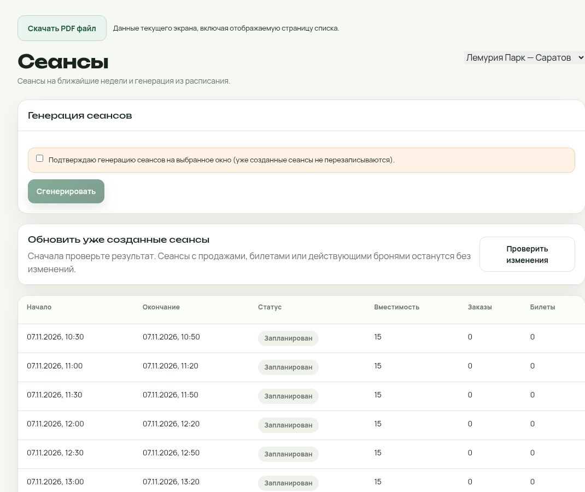

# CRM «Лемурия Парк»: фактический аудит и опубликованные исправления

Проверки: 6 ноября — 7 ноября 2026, после полуночи по Москве.
Контрольный публичный HTTP-замер: **07.11.2026, 00:26 МСК**.

**Статус: аудит частичный, production работает.** Подтверждённые ошибки
отображения времени в обзоре и разделе «Сеансы» исправлены через staging.
Проверка каждой изменяющей кнопки под каждой реальной ролью НЕ завершена.
Нельзя считать этот документ полной приёмкой CRM.

## Фактический production и откат

| Параметр | Значение |
|---|---|
| Release ID | `crm-localtime-20261106-26ae1073` |
| SHA сборщика overlay | `26ae10732d2a239b775ff0ae67b982f48aa2be68` |
| Активная revision | `bbarejmvsp7n2k0qu9b2` |
| Immutable digest | `sha256:3cd822308d4a3291ed40e34882401076cf93a1c9fa225a1ddb9dfc94d6ee81f7` |
| Предыдущий проверенный digest | `sha256:40338679c4ad314a9a3f90cd17cd792edee63b822fb2caaa687b677116541bbd` |
| Исходный digest до этой проверки | `sha256:c524919964093de59cfe2449ef9a6bfe48925b04eae1a0d811e9b37b0bac9589` |
| Registry | `cr.yandex/crprmg5vv1ubl0u4fpad/lemuria-app` |
| Публикация | Две последовательные точечные версии, каждая сначала staging, затем production |

SHA health — версия сборщика overlay, **не полный исходник всех файлов образа**.
Полный старый исходник из PR №2 не разворачивался.

Сохранены предыдущие образы и ревизии. Приватные снимки конфигурации находятся
в Cloud Shell; их содержимое не опубликовано. Команда `rollback-production`
из `scripts/cloud-crm-timezone-release.py` восстанавливает предыдущий
проверенный digest и его environment. Перед откатом сверяется текущий image.
Если сессия Cloud Shell потеряна, конфигурацию нужно получить из сохранённой
предыдущей ревизии и развернуть её immutable image; не восстанавливать БД.

После публикации фактически сравнены environment и поля ресурсов, сети,
service account, ссылок на секреты, concurrency и настроек ревизии:
`CONFIG_PRESERVED=true`, кроме предусмотренных RELEASE_ID/GIT_SHA/image.
Новые роли, пользователи, резервы, заказы, платежи и возвраты не создавались.
Миграции, seed и удаления не выполнялись.

## Исправлено и проверено

| Дефект | Исправление | Доказательство |
|---|---|---|
| Саратов 10:30 показывался как 09:30 в общем обзоре | Для сеанса выбирается timezone его локации из метаданных API | В production Саратов 10:30, Волгоград 10:30; UTC-моменты в БД не менялись |
| Та же ошибка в таблице «Сеансы», в начале и окончании | Форматтер использует уже имеющееся `session.location.timezone` | Первая строка Саратова теперь 10:30–10:50, следующая 11:00–11:20 |
| Время открытия саратовской смены в общем обзоре отличалось от карточки | Часовой пояс выбирается по метаданным локации | Тест смешанного списка Саратов/Волгоград; бизнес-сервисы смен сохранены |

Для каждой версии: проверки синтаксиса изменённых JS; health live/ready;
`database=ok`; манифест релиза; SHA256 каждого изменённого публичного JS.
На итоговом staging и production проверено по два изменённых JS-ресурса.
Все восемь локальных тестов прошли: четыре — форматирование реальных
публичных bundles, четыре — сохранение конфигурации и откат.

## Доступность, TLS и облако

| Компонент | Результат |
|---|---|
| Главная сайта | OK, HTTP 200, заголовок зоотеатра в Саратове, содержательная страница |
| `/about` | OK, HTTP 200, страница «О зоотеатре лемуров» |
| CRM `/` без авторизации | OK, HTTP 200, штатный вход сотрудников; неожиданных редиректов нет |
| Live/ready обоих доменов | OK, HTTP 200; ready возвращает `checks.database=ok` |
| Текущий CSS из полученного HTML | OK, `/_next/static/css/136869e988782106.css`, HTTP 200, 27 417 байт |
| API Gateway `d5dt6slu3sr4tpmalbta` | ACTIVE |
| Контейнер `bbaqa5r6njb9nrqhaohq` | Активная новая ревизия, её digest совпал с кандидатом |
| PostgreSQL `c9qm31p79k9shqum4hco` | RUNNING / ALIVE |
| Биллинг | Баннер блокировки ресурсов не обнаружен; отображался отрицательный баланс. Платежи не выполнялись |
| Cloud Logging | Два чтения вернули `Unavailable`; причина прежнего Application error по логам не установлена |

Прямой TLS из Yandex Cloud: TLS 1.3, цепочка и hostname проверены стандартным
trust store. Сертификат сайта Let’s Encrypt YR1 до 07.12.2026 11:07:47 UTC;
CRM Let’s Encrypt R11 до 06.01.2027 08:43:22 UTC.

Замеры HTTP из сети инструментов: главная 14,00 с, `/about` 16,35 с,
CRM вход 6,89 с; health 4,10–8,50 с. Это наблюдаемая задержка через сетевой
прокси ChatGPT, не измерение времени SQL или серверного обработчика.
Сертификат прокси не выдаётся за сертификат production.
Машиночитаемые контрольные результаты — `crm-http-evidence-20261107.json`.

`database=ok` подтверждает соединение, но не полноту, целостность, отсутствие
дублей или финансовую сверку всех данных.

## Публичные сеансы, карта и промокод

`/api/public/locations`: ACTIVE Саратов, Europe/Saratov, период
**07.11.2026–20.12.2026**; вторник — выходной. Выбрана актуальная открытая
дата 07.11, а не произвольная дата после завершения выставки.

`/api/public/sessions?locationSlug=saratov&date=2026-11-07`: HTTP 200,
**21 сеанс, 10:30–20:30**, каждые 30 минут; есть сеансы после 14:00.
Все 21 доступны в видимом выборе времени; шестистрочный блок «ближайшие»
явно отсылает к полному расписанию в форме. В существующем оплаченном сеансе
API показывает оставшиеся места 12 из 15.

Видимая форма загрузилась. Выбор одного взрослого пересчитал итог в 1 100 ₽;
«ВЫГОДА» вернул скидку 110 ₽ и итог 990 ₽. До оформления не переходили:
резерв/заказ/платёж не создавались. Проверена только предварительная скидка;
это не проверка её финального применения после оплаты.

Карта публичного сайта загрузилась с элементами Яндекс Карт; координаты
51.62132, 45.972246 переданы в порядке longitude,latitude для map-widget.
Тот же адрес и превью существуют в карточке локации CRM.

## Права и фактические роли

51 проверка **чистых функций реального compiled bundle** прошла без БД,
cookies, подмены сессий и входа от имени сотрудников.

| Роль / признак | Проверено в compiled-политике | Чего это не доказывает |
|---|---|---|
| CASHIER | Только назначенные локации; пустое назначение запрещает доступ; нет глобального отчёта парка | Продажу, оплату и ввод собственного отчёта под реальным кассиром |
| ADMIN | Своё назначение, запрет чужой/неназначенной локации; нет права менять кассовые цены; разрешён ввод отчёта | Каждый UI/API маршрут и каждый изменяющий сценарий |
| DIRECTOR | Своё назначение, запрет чужой/неназначенной локации; цены и отчёты | Полную финансовую сверку и ролевой браузерный прогон |
| ONLINE_MANAGER | Только назначенные локации; нет глобальных офлайн-отчётов | Все ограничения выделенного онлайн API и возвраты |
| OWNER | Все локации | Проверку каждого административного действия |
| readOnly | Запрещены запись парковых операций/отчётов и изменение цен для проверенных ролей | Все прочие write-endpoints |

Без авторизации 28 существующих staff GET API вернули 401. В актуальном UI
управления доступами просмотрены роли и назначения действующих аккаунтов.
Назначения и роли не менялись. Кабинеты ниже осматривались
под владельцем; это не считается входом и тестом под каждой должностью.

## Проверенные интерфейсы и кнопки

| Область | Что фактически выполнено | Ограничение |
|---|---|---|
| Кабинет директора | Загрузились обзор, аналитика, отчёты, заказы, смены, билеты, расписание, сеансы, цены, типы, локации, сотрудники, контент, аудит, настройки, профиль | Открытие раздела не равно проверке всех сохранений |
| Смены | Сегодня/30 дней, загрузка данных, открытие карточки | Старые смены не закрывались |
| Аналитика/отчёты | Выбор Саратова, Europe/Saratov, ссылка ввода отчёта с source=CASHIER | На пустом периоде нельзя подтвердить ненулевые суммы |
| Сотрудники | Общий список и новая форма открываются; доступны назначения и ONLINE_MANAGER; форма закрыта без создания | Сбросы паролей/новые доступы не выполнялись |
| Контент | Общая/локальная область переключается, FAQ/галерея/превью загружаются | Не сохранялись тексты и изображения |
| Экспорт | CSV журнала: 139 строк данных + заголовок, совпадает с таблицей. PDF профиля скачался, 19 713 байт, PDF-1.3 с EOF | Полная визуальная приёмка каждого вида PDF/печать не выполнены |
| Онлайн-кабинет | Обзор, выбор локации, заказы, промокоды, прайс и контент загрузились; просмотрен ненулевой период Саратова | Просмотр под OWNER; сверки с БД, возвратов и изменения цен не было |
| Касса | Продажа и текущая смена/форма заполнения отчёта загрузились | У владельца старая смена в приостановленной локации, сеансы не загружаются |

## Оставшиеся дефекты и рекомендации

| Приоритет | Наблюдение | Следующий шаг |
|---|---|---|
| P1 | Полный исходник реального production отсутствует в доступной ветке и Cloud Shell; исходный release-manifest содержит dirty checkout другого gitHead | Восстановить исходник/lockfile/schema текущего образа, добавить воспроизводимую сборку и сравнение image/source. Не разворачивать целиком PR №2 |
| P1 | Legacy-список билетов показывает существующий саратовский сеанс как 15:30, онлайн-кабинет и API — 16:30; ticket API не передаёт timezone локации | Добавить timezone в контракт tickets и передавать в форматтер. После staging сверить один sessionId во всех интерфейсах и PDF. В этом релизе не исправлено |
| P1 | Три давно открытые смены; в кассе владельца смена относится к площадке на паузе, возникает «Активная локация не найдена» | Сверить остатки и ответственных, затем штатно закрыть старые смены. Показать понятное действие для смены в приостановленной локации; не переносить продажи автоматически |
| P2 | Обзор сообщает «Cleanup ещё не фиксировался». В YC trigger v2 найден только PAUSED `lemuria-staging-cleanup`; production cleanup там не обнаружен | Проверить внешний планировщик и журнал успешных запусков, согласовать безопасный cleanup. Нельзя считать отсутствие YC-триггера доказательством отсутствия любого cron |
| P2 | В фильтре роли `/admin/users` отсутствует ONLINE_MANAGER, хотя аккаунт и опция создания существуют | Согласовать фильтр с реальным enum, проверить фильтрацию сервером |
| P2 | Общий итог кассового отчёта объединяет билеты, корм, фото и Балабас; онлайн исключён | Для требования «только билеты» использовать отдельный показатель и явно назвать общий итог; сверить ненулевые операции и возвраты до изменения учёта |
| P2 | Системные npm-пакеты вне `/app/node_modules` имеют известные advisories | При воспроизводимой сборке обновить базовый образ/убрать служебный npm из runtime. Не переносить их advisories на приложение без анализа достижимости |
| Не проверено | Мобильные 360/390/430 px, Safari/Android, камера/QR-сканирование, принтер | Нужна управляемая мобильная среда; текущий браузер остался 1348 CSS px, попытка включить device toolbar размер не изменила |
| Не проверено | ЮKassa sandbox, конкурентные продажи, повторы webhook/возврата, отрицательные сценарии каждой роли, backup restore | Изолированные тестовые учётки и финансовая sandbox-конфигурация, затем сценарная приёмка |

## Зависимости именно рабочего образа

Из immutable image прочитаны manifests, приложение не запускалось. Для
`/app/node_modules`: **52 имени / 53 manifests**, npm Bulk Advisory вернул
**0 advisories** для переданных версий на момент проверки.
Next.js **15.5.28**, React/React DOM **19.2.8**, Prisma Client **6.19.3**.

Отдельный обзор всего образа нашёл 252 имени / 286 manifests, включая
служебный npm вне приложения; в этой расширенной группе есть advisories.
Это разные области проверки. Результат старого `npm audit` из PR №2
не является результатом аудита production.

Проверка по manifests не доказывает отсутствие проблем в vendored-коде без
версии, ОС, бизнес-логике или неизвестных уязвимостей. Принудительные массовые
обновления зависимостей в production не выполнялись.

## Что требуется для полной приёмки

Полный исходник соответствующего образа; действующие тестовые учётные записи
каждой роли в изолированном staging; sandbox платежей, чеков и доставки.
Затем — проверка каждого действия и его отказа, матрица ролей/локаций,
сверка финансов, проверки конкурентности и мобильных устройств.
Только после этого можно выпускать окончательные инструкции по должностям
и подтверждать «проверена каждая кнопка».
