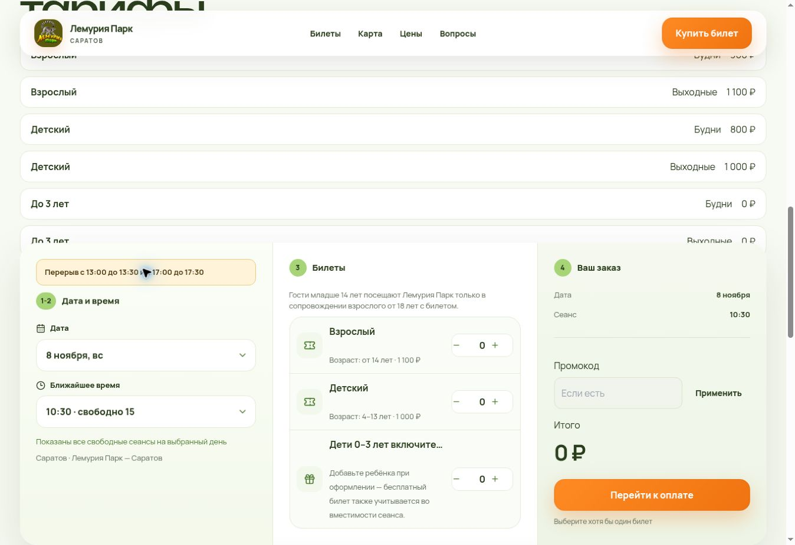

# Saratov daily breaks — production acceptance 2026-11-07

- Release: `saratov-breaks-20261107-3e35c28f`
- Builder commit: `3e35c28f4e9b610ef39b63f33f58145e4d61b32a`
- Immutable image: `sha256:cbfe23d7bf337b788c6484020ff24cf08aa0c6541b1afddcfb927683a64a88ae`
- Production revision: `bbadvjh291ebhq4sm454`
- Staging revision: `bbargh5hv93uo1ghphoc`
- Rollback image: `sha256:012c2ea57d26ac12a8e781f971447fe391a76b6289b3c9b0c261d7a581fec91c`

Scope: Saratov sessions whose local start time falls within [13:00,13:30) or [17:00,17:30), daily from 2026-11-07. Lists of bookable sessions exclude these rows. Direct session lookup for new booking/quote/sale refuses these times. No database row, order, ticket, reservation or payment was changed. Historical dates before activation and other location slugs are unaffected.

The exact public and cashier notice reads: **Перерыв с 13:00 до 13:30 и с 17:00 до 17:30**.

Validation:
- Fifteen tests passed: local-time boundaries, activation dates, other locations, read-only filtering, direct lookup rejection, public notice and unchanged cashier sale handler.
- Exact current production artifact patched: five repository copies, one public client/server component and one cashier client/server component. Syntax checks passed.
- Staging verified before production: matching health SHA, database=ok and both changed static JS hashes. Public API for November 8 excludes 13:00/17:00 and retains 13:30/17:30. Read-only promo quotes using old blocked session IDs return 404 SESSION_NOT_FOUND.
- Production: health/ready database=ok; matching release/SHA and both static hashes verified.
- Production public APIs for November 7, November 8 and December 20 each expose 19 sessions, exclude 13:00/17:00 and retain 13:30/17:30.
- Production direct lookup test for 13:00 returned 404 SESSION_NOT_FOUND. The initial 17:00 probe hit 503 DATABASE_TEMPORARILY_UNAVAILABLE; after a short interval, readiness was 200/database=ok and one repeat returned the required 404 SESSION_NOT_FOUND.
- Browser verified the notice and absence of both blocked times in the public dropdown and authenticated cashier session cards.
- No order, reservation, charge, refund, mail or database fixture was created for this release.

The pre-change public availability showed occupied places on a blocked session. Existing bookings were preserved, and the owner was told to coordinate attendance with affected guests.

Rollback: `cloud-session-break-release.py rollback-production` with the protected Cloud Shell snapshot. Previous immutable image and revision settings retained.

